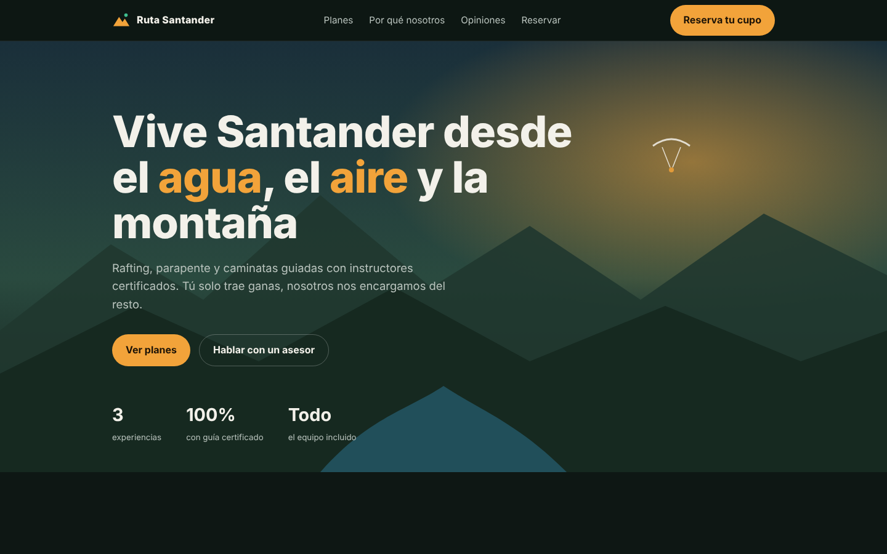

# Ruta Santander · Landing page demo

Demo landing page for a fictional adventure tourism agency in Santander, Colombia (rafting, paragliding and hiking).

**Live demo:** https://thebird45.github.io/ruta-santander/

## Features

- Fully responsive layout (desktop, tablet and mobile) with a mobile menu
- Hero section with an inline SVG illustration (no external images)
- Tour cards with prices, a "why us" section and testimonial placeholders
- Booking form with client-side validation and a confirmation message
- Scroll-reveal animations using `IntersectionObserver`
- Built with plain HTML, CSS and vanilla JavaScript: no frameworks, no dependencies, one file

## Run it locally

Open `index.html` in any browser.

---

Design & development: Juan B. · This is a demo site; the business and testimonials are placeholders.
